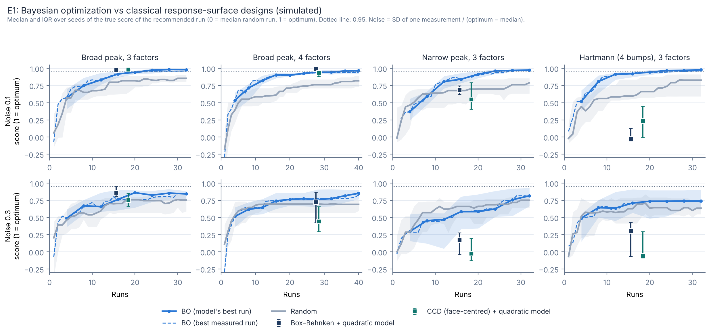

# E1: simulated benchmark, classical DoE vs Bayesian optimization

**Question.** Does Bayesian optimization (BO) reach 95 % of the best possible
result in fewer runs than a classical response-surface design?
(Target in `experiments/README.md`: at least 30 % fewer runs, median over 20 seeds.)

## Setup

Code: `problems.py` (test problems), `benchmark.py` (runs), `summarize.py`
(tables and figure). Results in `results/`.

**Problems.** Functions on [0, 1]^d with a known optimum, maximized. The "lab"
returns the function value plus Gaussian noise.

| Problem | Factors | Shape | Who should do well |
| --- | --- | --- | --- |
| Broad peak (`peak3`, `peak4`) | 3, 4 | one smooth optimum off-centre, interacting factors; close to a quadratic over the box | classical (its home ground) |
| Narrow peak (`peak3_narrow`) | 3 | the same optimum, 1.8 times narrower: ranges chosen too wide | neither by design |
| Hartmann (`hartmann3`) | 3 | four bumps, global optimum near a corner | BO |

**Noise.** SD of one measurement = 0.1 or 0.3 times the gap between a typical
random run and the optimum. For scale: in the first lab batch (25 Nov) the
replicated condition had a CV of about 8 %. Whether that is 0.1 or 0.3 of the
gap depends on how much the factors can improve the response, which is still
unknown.

**Strategies** (all use the engine code that the lab uses):

- **Box–Behnken** and **face-centred CCD** (`engine.classical`, 3 centre points),
  measured once, then the quadratic model and its predicted optimum
  (`engine.rsm`). The lab would run that optimum once to confirm it, so the
  classical result counts design runs + 1: 16 (BBD) and 18 (CCD) runs for
  3 factors, 28 for 4 factors.
- **BO** (`engine.bo.recommend`, BayBE defaults): batches of 4. The first batch is
  a maximin Latin hypercube. Budget 32 runs (3 factors) or 40 (4 factors).
  After each batch, the recommended condition is the run with the highest model
  (posterior) mean. Like the classical model, this averages out the noise of a
  single measurement. The dashed curve shows the alternative "best measured run".
- **Random**: uniform random runs, best measured run (sanity baseline).

**Score.** True (noise-free) value of the recommended condition:
0 = median random run, 1 = optimum (same convention as E2). 20 seeds; classical
and BO are compared at the same number of runs, paired by seed (Wilcoxon).

Reproduce (about 40 min on 2 CPU cores):

```bash
python experiments/e1/benchmark.py --seeds 20 --noise 0.1 0.3 --out experiments/e1/results
python experiments/e1/summarize.py experiments/e1/results/e1_runs.csv
```

## Results



Same number of runs, noise 0.1 (median over 20 seeds; full tables in
`results/e1_summary.md`):

| Problem | Classical (runs): score | BO at the same runs | BO − classical (p) | Runs to 0.95: classical / BO (seeds reaching) |
| --- | --- | --- | --- | --- |
| Broad peak, 3 factors | BBD (16): 0.98 | 0.92 | −0.06 (p < 0.001) | 16 (90 %) / 22 (90 %) |
| Broad peak, 4 factors | BBD (28): 0.99 | 0.94 | −0.04 (p = 0.03) | 28 (75 %) / 34 (65 %) |
| Narrow peak, 3 factors | BBD (16): 0.69 | 0.84 | +0.15 (p = 0.002) | not reached (0 %) / 24 (90 %) |
| Hartmann, 3 factors | BBD (16): −0.03 | 0.92 | +0.87 (p < 0.001) | not reached (0 %) / 20 (90 %) |

The face-centred CCD gives a similar picture (0.98, 0.94, 0.55 and 0.23 in the
same order).

With noise 0.3, no strategy reliably reaches 0.95 within the budget (BO: 10–30 %
of seeds). The classical model's optimum often lands in the wrong place: score
0.17 (narrow peak) and 0.31 (Hartmann) for the Box–Behnken design, against 0.58
and 0.71 for BO. On the broad peaks the two are level (3 factors: Box–Behnken
0.86 vs BO 0.76, p = 0.45; 4 factors: 0.72 vs 0.76, p = 0.25).

## What it shows

- **The answer depends on the shape of the response.** When the response is a
  smooth single peak that a quadratic describes well, one classical design
  already lands on the optimum, and BO needs about 20–40 % *more* runs to get
  there. The E1 target (30 % fewer runs) is not met in that case.
- **When the quadratic does not fit** (optimum narrower than the ranges, or
  several local optima), the classical design's predicted optimum is far from the
  real one, and one design never reaches 0.95. BO reaches it in 20–24 runs in
  90 % of seeds. A lab would need follow-up designs here, so the classical run
  count would grow beyond the 16–18 runs of the first design.
- **Noise matters as much as the method.** At noise 0.3 neither approach
  reliably reaches 0.95. Replicates and a response with a large effect (see the
  first lab batch: flat response in water at natural pH) matter more than the
  choice of optimizer.
- **The recommendation rule matters for BO.** Taking the model's best run
  instead of the best single measurement is more reliable under noise (e.g.
  Hartmann: 90 % vs 70 % of seeds reach 0.95).

## Limits

- Synthetic problems; the real case-study surface is unknown. The Borkowski et
  al. (2020) simulator is the next problem to add.
- The classical baseline is one design and its predicted optimum. In practice a
  lab may follow up (steepest ascent, a second design around the optimum),
  which this benchmark does not simulate yet.
- BO uses BayBE defaults (GP surrogate, batch acquisition) with batches of 4;
  no tuning.
