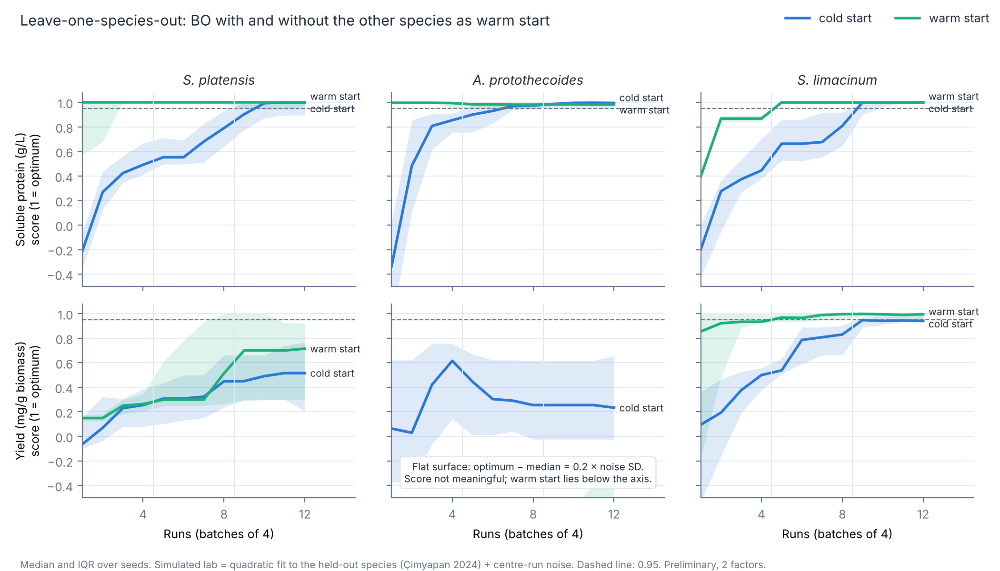

# E2: value of prior knowledge (warm start)

## Preliminary check: leave one species out (Çimyapan 2024 thesis data)

**Question.** If the optimizer meets a new microalga, does data from the other
two species help it find good extraction conditions in fewer runs?

**Setup** (`loso_thesis.py`, results in `results/`):

- Hold out one species. Its simulated lab is a quadratic fit to its own 13
  thesis runs (inside its tested box) plus noise with the SD of its centre
  replicates.
- Cold BO: no prior data, first batch a Latin hypercube.
  Warm BO: the other two species as related tasks (BayBE transfer learning).
- 3 rounds × 4 runs = 12 runs, 20 seeds, paired (same seeds and noise draws
  for cold and warm). Two objectives: soluble protein (g/L) and yield (mg/g).
- Score: true value of the best observed run; 0 = median random run,
  1 = optimum of the simulated lab (same convention as E1).

Reproduce (about 1 h on 2 CPU cores):

```bash
python experiments/e2/loso_thesis.py --seeds 20 --out experiments/e2/results
python experiments/e2/summarize_loso.py experiments/e2/results/loso_thesis_runs.csv
```

**Results** (median over 20 seeds; full table with IQR in
`results/loso_thesis_summary.md`):

| Held-out species | Objective | Runs to 0.95, cold → warm | Warm − cold score at 8 runs (Wilcoxon p) |
| --- | --- | --- | --- |
| S. platensis | g/L | 10 → 1 | +0.16 (p = 0.002) |
| A. protothecoides | g/L | 7 → 1 | 0.00 (p = 0.65); both at ≥ 0.97 by then |
| S. limacinum | g/L | 9 → 5 | +0.19 (p < 0.001) |
| S. platensis | yield | not reached in 12 runs (25 % → 40 % of seeds) | +0.12 (p = 0.08) |
| S. limacinum | yield | 9 → 5 | +0.12 (p < 0.001) |
| A. protothecoides | yield | flat surface, not meaningful (see below) | — |



**What it shows**

- For **g/L**, warm start reaches 95 % of the optimum after 1–5 runs instead
  of 7–10. This is partly easy: in every species g/L rises with biomass, so the
  optimum sits at the biomass limit and the other species reveal this.
- For **yield**, warm start helps where the held-out species behaves like the
  others (S. limacinum: 9 → 5 runs) and helps a little for S. platensis.
- **A. protothecoides yield is flat**: its optimum is only 0.7 mg/g above a
  random run (0.2 × the noise SD), so the score just amplifies noise. Warm start
  sends the first runs to the low-biomass corner (the other species' best
  region), about 2 mg/g worse there. This is a mild case of negative transfer and
  a reminder that transfer helps only when the tasks are similar.
- **Yield is noisy at low biomass**: yield = protein / biomass, so a fixed
  protein error becomes a large yield error at 10 g/L (6 mg/g vs 1.2 mg/g at
  50 g/L for A. protothecoides). The "best looking" run can be a lucky
  low-biomass one. If yield becomes the E3 response, replicate the best runs.

**Limits**

- Simulated labs are quadratic fits. S. limacinum's fit predicts poorly
  (leave-one-out Q² 0.07), so its rows are the least reliable.
- Two factors only; the case study will have three.
- All three species were extracted with the same probe and protocol. The E3
  experiment uses an ultrasonic bath, so the thesis data will be less similar to
  it than the species are to each other here; expect a smaller benefit.

This is a check of the mechanism, not the E2 result. E2 proper (Dec) repeats
the comparison on the E1 problems and, if possible, with the first lab data.
